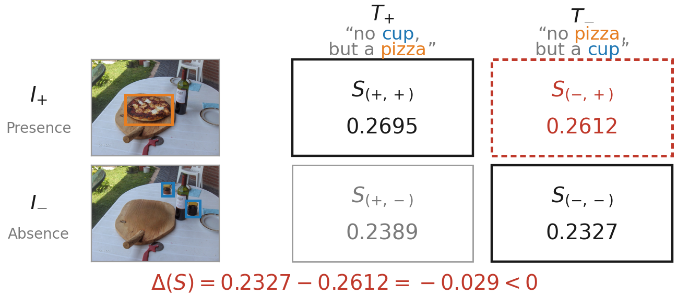
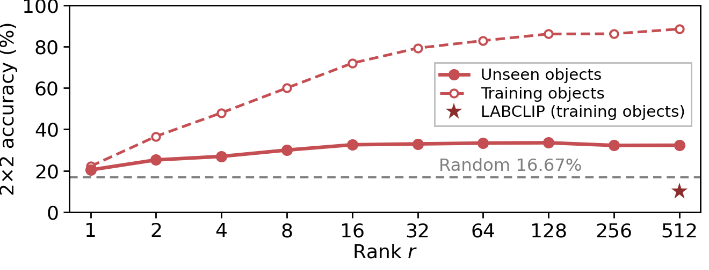

# 객체 단위 통제로 본 CLIP 부정 이해의 병목 분석과 저계수 이중선형 변환

**Analyzing CLIP's Negation Bottleneck under Object-Level Control with a Low-Rank Bilinear Transform**

[이준서](mailto:junseolee@ajou.ac.kr), [조현석](mailto:hyunsouk@ajou.ac.kr)\*
아주대학교 소프트웨어학과

**제7회 한국인공지능학술대회 (Korea AI 2026)**

[](https://koreaai.org/)
[](LICENSE)


[English (README.md)](README.md)

<p align="center">
  
</p>

CLIP은 부정이 포함된 질의에서 실패한다. 본 연구는 이 실패가 *어디에서* 일어나는지를 묻는다. 한 장의 사진에서 객체 O를
지운 이미지와 다른 객체를 지운 이미지를 짝지어 장면을 고정하고, 단어 집합은 같고 부정하는 객체만 다른 두 캡션과
교차한다. 이렇게 하면 부정 이해는 2×2 판정 문제가 되며, 일치하는 두 이미지–캡션 쌍의 점수가 어긋난 두 쌍의 점수보다
모두 높아야 한다.

이어서 병목 후보를 앞 단계부터 하나씩 소거한다.

- **표현.** 선형 프로브는 이미지 임베딩에서 객체의 존재를, 텍스트 임베딩에서 부정을 무작위 초기화 인코더보다 높은
  정확도로 복원한다.
- **정렬.** 텍스트 프로브의 법선을 이미지 프로브의 법선으로 회전시켜 코사인 유사도를 1.000으로 맞추어도, 2×2 판정
  정확도는 무작위 확률의 약 5분의 1에 머문다.
- **유사도 함수.** 코사인 유사도에 숨어 있는 항등 행렬을 모든 객체가 공유하는 저계수 이중선형 변환
  `S(e_I, e_T) = (U e_I)ᵀ(V e_T)`로 바꾸면, 학습에 없던 객체에서도 2×2 판정 정확도가 오른다. NegBench MCQ의 부정
  문항 성능도 인코더를 재학습하지 않고 향상된다.

## 소식

- **2026.10.01**: 제7회 한국인공지능학술대회에서 구두 발표(온라인)하였다.
- **2026.09**: 코드와 학습된 행렬, 논문의 모든 수치가 나온 원본 산출물을 공개하였다.

## 방법

객체 O에 대해 `T+`/`T−`를 O를 긍정/부정하는 캡션, `I+`/`I−`를 O가 있는/없는 이미지라 하자. 캡션 `T_u`와 이미지
`I_v`의 점수를 `S(u, v)`로 쓰면, 한 쌍에서 채점 함수가 옳을 조건은 다음과 같다.

```
ΔS = min(S(+,+), S(−,−)) − max(S(−,+), S(+,−)) > 0
```

네 점수의 순서가 무작위라면 이 조건은 1/6(16.67%)의 확률로 성립한다. 반면 코사인 유사도는 1.35%의 쌍에서만 이를
만족하므로, 이 실패는 무작위 잡음이 아니라 체계적이다.

코사인 유사도는 `W = I`인 이중선형 형식 `e_Iᵀ W e_T`이다. 본 연구는 `U, V ∈ R^{r×n}`으로 분해한 저계수 행렬
`W = UᵀV`(파라미터 `n²` 대신 `2nr`개) 하나를 ΔS에 대한 힌지 손실로 학습한다. 이 행렬은 모든 객체가 공유하며, 학습에서
제외한 객체로 평가한다.

## 결과

**표 1.** CLIP ViT-B/32의 이미지와 텍스트 임베딩에 대한 객체별 선형 프로빙 정확도(객체 평균).

| 인코더 | 이미지 | 텍스트 |
|:--|:--:|:--:|
| 무작위 초기화 | 0.52 | 0.54 |
| OpenCLIP | 0.66 | 0.86 |
| OpenCLIP (ft) [NegBench] | 0.65 | 0.93 |

**표 2.** 객체별 프로브 법선의 정렬도와 그에 따른 2×2 판정 정확도.

| 유사도 | cos(d_I, R d_T) | ΔS > 0 (%) |
|:--|:--:|:--:|
| 코사인(기준선) | 0.219 | 1.35 |
| 직교 회전 R_o | 1.000 | 3.25 |
| 무작위 회전 | 0.002 | 0.12 |

**그림 2.** 계수에 따른 저계수 이중선형 변환과 LABCLIP의 2×2 판정 정확도.

<p align="center"></p>

**표 3.** 외부 벤치마크 정확도(%). 두 변환 모두 BEAF 쌍으로 학습한 뒤 제로샷으로 평가하였다. Ours는 r = 32이며,
Avg는 혼합(hybrid) 문항을 포함한다.

| 유사도 | COCO Avg | COCO Pos | COCO Neg | VOC2007 Avg | VOC2007 Pos | VOC2007 Neg | CheXpert |
|:--|:--:|:--:|:--:|:--:|:--:|:--:|:--:|
| 무작위 | 25.00 | 25.00 | 25.00 | 25.00 | 25.00 | 25.00 | 50.00 |
| 코사인 | 39.30 | 69.14 | 6.84 | 38.72 | 82.55 | 3.35 | 55.61 |
| LABCLIP | **47.02** | **82.23** | 6.42 | 40.95 | **84.75** | 6.46 | 37.43 |
| **Ours** | 45.25 | 61.52 | **24.22** | **51.88** | 73.61 | **22.40** | **58.82** |

## 설치

```bash
git clone https://github.com/qofo/lowrank-bilinear-negation.git
cd lowrank-bilinear-negation
conda create -n lbn python=3.9 -y && conda activate lbn
pip install -r requirements.txt
```

이 코드는 NegBench가 수정한 OpenCLIP(`benchmarks/src/open_clip`)을 저장소 안에 포함하여 사용한다. 이 OpenCLIP은
패키지로 설치하지 않는다. `scripts/reproduce_paper.sh`가 이를 `PYTHONPATH`에 올린다. 모듈을 직접 실행할 때는 저장소
루트에서 먼저 경로를 설정한다.

```bash
export PYTHONPATH="$PWD:$PWD/benchmarks:$PWD/benchmarks/src"
```

## 데이터

CSV는 `benchmarks/data/images/`에 포함되어 있다. 이미지는 각 원 출처에서 받는다.

| 데이터셋 | 쓰이는 곳 | 출처 | 검증 목록 |
|:--|:--|:--|:--|
| BEAF v1 (`beaf_dataset_ver1.zip`, 이미지 2,224장) | 표 1–2, 그림 1–2, 두 변환의 학습 | [Google Drive (BEAF 저자)](https://drive.google.com/file/d/1Xx7j8Hz8QX3Fl_hpSBet6r15njhwCgeR/view) | `beaf.sha256` |
| COCO 2017 val (`val2017.zip`) | 표 3, COCO MCQ | [cocodataset.org](http://images.cocodataset.org/zips/val2017.zip) | `coco_val2017.sha256` |
| PASCAL VOC2007 test (`VOCtest_06-Nov-2007.tar`) | 표 3, VOC2007 MCQ | [host.robots.ox.ac.uk](http://host.robots.ox.ac.uk/pascal/VOC/voc2007/VOCtest_06-Nov-2007.tar) | `voc2007.sha256` |
| CheXpert-v1.0-small (검증 분할) | 표 3, CheXpert | [NegBench가 사용한 Kaggle 미러](https://www.kaggle.com/datasets/ashery/chexpert). CheXpert 연구 이용 약관이 적용된다 | `chexpert.sha256` |

`scripts/prepare_data.sh`는 각 압축 파일을 CSV가 기대하는 위치에 푼다. 그다음 CSV가 참조하는 모든 이미지를
`benchmarks/data/checksums/`의 SHA-256 목록과 대조한다.

```bash
bash scripts/prepare_data.sh --beaf beaf_dataset_ver1.zip --coco_val2017 val2017.zip \
    --voc2007 VOCtest_06-Nov-2007.tar --chexpert /path/to/CheXpert-v1.0-small
```

표 3을 제외한 모든 실험은 BEAF zip 하나만으로 재현할 수 있다.

**체크포인트.**
- OpenAI CLIP ViT-B/32 가중치는 OpenCLIP이 자동으로 내려받는다.
- 표 1의 미세조정 인코더는 NegBench의 `CLIP_CC12M_NegFull_ViT-B-32_lr1e-8_clw0.99_mlw0.01`이다.
  [NegBench 모델 폴더](https://drive.google.com/drive/folders/1kSEq0mkV1t1T8GuOAM65iz_iAA7e5gxB)에서 받아
  `benchmarks/models/CLIP_CC12M_NegFull_ViT-B-32_lr1e-8_clw0.99_mlw0.01/checkpoint.pt`에 둔다
  (sha256 `23a68e31da76f95670c4167cb2980e52fbd1eba77c8932cc36ade75efadfeb70`).
- 표 3에 쓰인 두 학습 행렬은 `checkpoints/`에 있다. Ours는 `delta_warmstart_rank32.pt`,
  LABCLIP은 `labclip_official_recipe_bilinear.pt`이다.

## 논문 재현

```bash
bash scripts/reproduce_paper.sh all      # 또는 단계를 지정: table2 figure2 compare
```

모든 단계는 이미지에서 임베딩을 새로 계산하여 `outputs/paper/`에 쓴다(`OUT`으로 위치를 바꿀 수 있다). 마지막 단계인
`compare`는 `outputs/paper/compare_with_paper.csv`를 쓴다. 이 파일에는 논문에 인쇄된 각 수치가 그 수치가 나온 원본
로그(`results/reference/`) 및 방금 재현한 값과 나란히 놓인다.

RTX 4070 한 장에서 전체 실행은 약 90분이 걸리며, 그중 70분이 표 1의 세 프로브이다. 새 환경에서 실행하면 논문에 인쇄된
61개 수치가 모두 재현되고, 학습된 두 행렬도 비트 단위로 같다. 유일한 예외는 표 1의 무작위 초기화 행이다. 원래 실행이
무작위 인코더에 시드를 주지 않아 값이 소수 셋째 자리에서 달라진다(0.5246 / 0.5441 대 0.5230 / 0.5354). 그래도
반올림하면 인쇄된 0.52 / 0.54와 같다. 지금 스크립트는 시드를 고정하므로 반복 실행하면 같은 값이 나온다.

| 논문 항목 | 단계 | 모집단 | 스크립트 |
|:--|:--|:--|:--|
| 표 1 | `table1_openai`, `table1_random`, `table1_negft` | 이미지: 원본과 객체 제거본 쌍의 76개 객체(쌍 단위 GroupKFold). 텍스트: 단어 교환 캡션의 69개 객체(StratifiedKFold) | `eval_probe_failure_inspector.py` |
| 2.2절(1.35%), 표 2 | `table2` | 원본과 객체 제거본 쌍의 33개 객체, 1,357쌍. 홀드아웃 열은 원본 이미지 단위 GroupKFold | `eval_per_object_alignment_intervention.py` |
| 그림 2(곡선) | `figure2` | 한 이미지에서 두 객체를 각각 지운 쌍의 42개 객체, 2,480쌍. 객체 단위 GroupKFold | `eval_single_w_generalization.py` |
| 그림 2(LABCLIP 별표) | `labclip`, `star` | LABCLIP은 전체 2,771쌍(77개 객체)으로 학습하고 42개 객체에서 채점 | `train_labclip_official_recipe.py`, `score_delta_s_for_w.py` |
| 표 3(Ours) | `ours` | 42개 객체 2,480쌍 전체로 학습한 rank-32 W | `train_and_save_narrow_rank32_w.py` |
| 표 3 | `table3` | COCO MCQ 5,914문항, VOC2007 MCQ 5,031문항, CheXpert 187문항 | `eval_w_ckpts_mcq.py` |
| 그림 1–2 | `figure1_plot`, `figure2_plot` | 그림 1의 피자/컵 쌍 | `paper_figures/` |

학습 없이 공개한 두 행렬만으로 외부 벤치마크를 채점하려면 다음을 실행한다.

```bash
python -m benchmarks.src.evaluation.eval_w_ckpts_mcq \
    --ckpts checkpoints/delta_warmstart_rank32.pt checkpoints/labclip_official_recipe_bilinear.pt \
    --targets benchmarks/data/images/COCO_val_mcq_llama3.1_rephrased.csv \
              benchmarks/data/images/VOC2007_mcq_llama3.1_rephrased.csv \
              benchmarks/data/images/chexpert_binary_mcq_control_valid_only.csv \
    --output outputs/table3_released.json
```

테스트는 `python -m pytest benchmarks/tests`로 실행한다(약 1분, 이미지 불필요).

## 저장소 구조

```
benchmarks/
  src/
    open_clip/          저장소에 포함한 OpenCLIP (NegBench 수정판)
    analysis/           특징 추출, 특징 캐시, 공용 설정과 CLI 도우미
    evaluation/         논문의 모든 실험 (진입점은 위 표 참조)
    training/           MCQ 벤치마크용 CsvMCQDataset
    data_generation/    BEAF에서 단어 교환 캡션 쌍을 만드는 스크립트
  data/images/          CSV (캡션과 상대 이미지 경로)
  data/checksums/       CSV가 쓰는 모든 이미지의 SHA-256 목록
  tests/                결과가 기대는 불변식 (ΔS 항등식, 폴드 묶음, 동점 처리 등)
checkpoints/            Ours(rank 32)와 LABCLIP의 학습된 W
concept_sets/           표 2의 33개 객체 집합
paper_figures/          그림 1, 그림 2
results/reference/      논문의 각 수치를 읽어 온 원본 산출물
scripts/                prepare_data.sh, reproduce_paper.sh
```

## 인용

```bibtex
@inproceedings{lee2026negationbottleneck,
  title     = {객체 단위 통제로 본 {CLIP} 부정 이해의 병목 분석과 저계수 이중선형 변환},
  author    = {이준서 and 조현석},
  booktitle = {제7회 한국인공지능학술대회},
  year      = {2026}
}
```

## 감사의 글

이 코드는 코드 기반과 MCQ 벤치마크, 미세조정 인코더를 제공한 [NegBench](https://github.com/m1k2zoo/negbench)와
[OpenCLIP](https://github.com/mlfoundations/open_clip) 위에 만들어졌다. 통제된 이미지 쌍은
[BEAF](https://github.com/postech-ami/BEAF)에서 왔다. LABCLIP 기준선은
[CLIP-not-BoW-unimodally](https://github.com/kdariina/CLIP-not-BoW-unimodally)의 공식 학습 방식을 따랐다.

본 연구는 2026년 과학기술정보통신부 및 정보통신기획평가원의 SW중심대학사업의 연구결과로 수행되었음(2022-0-01077)

## 라이선스

MIT 라이선스를 따른다([LICENSE](LICENSE)). 저장소에 포함한 OpenCLIP은 자체 라이선스
(`benchmarks/src/open_clip/LICENSE_OPENCLIP`)를 유지한다. 이미지는 각 데이터셋에 귀속되며 이 저장소에서 재배포하지 않는다.
