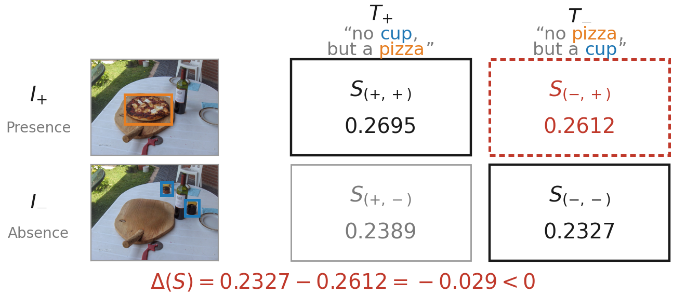
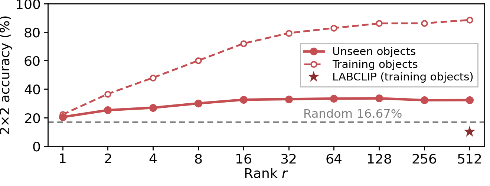

# Analyzing CLIP's Negation Bottleneck under Object-Level Control with a Low-Rank Bilinear Transform

[Junseo Lee](mailto:junseolee@ajou.ac.kr), [Hyunsouk Cho](mailto:hyunsouk@ajou.ac.kr)\*
Department of Software & Computer Engineering, Ajou University

**The 7th Korea Artificial Intelligence Conference (Korea AI 2026)**

[](https://koreaai.org/)
[](LICENSE)


[한국어](README.ko.md)

This is the official code for our Korea AI 2026 paper (Korean title: 객체 단위 통제로 본 CLIP 부정 이해의 병목 분석과 저계수 이중선형 변환).

<p align="center"></p>

CLIP is known to struggle with negated queries, but it is less clear which part of the model is responsible. We study this with object-removed images from BEAF. We take two versions of the same photo, each with a different object erased, and pair them with two captions that use the same words but negate different objects ("no cup, but a pizza" / "no pizza, but a cup"). A scorer gets a pair right only if both matching image–caption pairs score higher than both mismatched ones. Random scores would get this right 16.67% of the time; cosine similarity gets 1.35%.

We then check three places the failure could come from. Linear probes read object presence from the image embedding and negation from the text embedding clearly better than a randomly initialized encoder, so the information is there. Rotating the probe directions of the two modalities into perfect alignment only lifts accuracy to 3.25%, so misalignment is not the whole story either. That leaves the similarity function. We replace the identity matrix inside cosine similarity with one low-rank bilinear form, `S = (U e_I)^T (V e_T)`, shared by all objects. It beats chance on objects not seen in training. With both encoders frozen, it also raises negated-item accuracy on NegBench MCQ from 6.84% to 24.22% on COCO and from 3.35% to 22.40% on VOC2007.

## News

- **2026.10.01** Presented at Korea AI 2026 (online, oral).
- **2026.09** Code released.

## Results

**Table 1.** Per-object linear probing accuracy (averaged over objects), CLIP ViT-B/32.

| Encoder | Image | Text |
|:--|:--:|:--:|
| Random init | 0.52 | 0.54 |
| OpenCLIP | 0.66 | 0.86 |
| OpenCLIP (ft) [NegBench] | 0.65 | 0.93 |

**Table 2.** Cosine between the image and text probe normals, and 2×2 accuracy.

| Similarity | cos(d_I, R d_T) | ΔS > 0 (%) |
|:--|:--:|:--:|
| Cosine (baseline) | 0.219 | 1.35 |
| Orthogonal rotation R_o | 1.000 | 3.25 |
| Random rotation | 0.002 | 0.12 |

**Figure 2.** 2×2 accuracy vs. rank. Solid: objects held out from training. Dashed: training objects. Star: LABCLIP on its training objects.

<p align="center"></p>

**Table 3.** Accuracy (%) on external benchmarks. Both transforms are trained on our BEAF pairs only. Ours uses r = 32, and Avg includes the mixed (hybrid) items.

| Similarity | COCO Avg | COCO Pos | COCO Neg | VOC2007 Avg | VOC2007 Pos | VOC2007 Neg | CheXpert |
|:--|:--:|:--:|:--:|:--:|:--:|:--:|:--:|
| Random | 25.00 | 25.00 | 25.00 | 25.00 | 25.00 | 25.00 | 50.00 |
| Cosine | 39.30 | 69.14 | 6.84 | 38.72 | 82.55 | 3.35 | 55.61 |
| LABCLIP | **47.02** | **82.23** | 6.42 | 40.95 | **84.75** | 6.46 | 37.43 |
| **Ours** | 45.25 | 61.52 | **24.22** | **51.88** | 73.61 | **22.40** | **58.82** |

## Setup

```bash
git clone https://github.com/qofo/lowrank-bilinear-negation.git
cd lowrank-bilinear-negation
conda create -n lbn python=3.9 -y
conda activate lbn
pip install -r requirements.txt
```

We use NegBench's modified copy of OpenCLIP. It lives in `benchmarks/src/open_clip` and is not pip-installed. The scripts below set `PYTHONPATH` for you. If you run a module directly, do this first from the repo root:

```bash
export PYTHONPATH="$PWD:$PWD/benchmarks/src"
```

## Data

The CSVs are already in the repo (`benchmarks/data/images/`). The images have to come from the original sources:

- [BEAF v1](https://drive.google.com/file/d/1Xx7j8Hz8QX3Fl_hpSBet6r15njhwCgeR/view) (`beaf_dataset_ver1.zip`, from the BEAF authors). Needed for everything except Table 3.
- [COCO 2017 val images](http://images.cocodataset.org/zips/val2017.zip), for Table 3.
- [PASCAL VOC2007 test set](http://host.robots.ox.ac.uk/pascal/VOC/voc2007/VOCtest_06-Nov-2007.tar), for Table 3.
- CheXpert-v1.0-small, validation split, from the [Kaggle mirror NegBench uses](https://www.kaggle.com/datasets/ashery/chexpert), for Table 3. The CheXpert research use agreement applies.

Then pass whatever you downloaded to `prepare_data.sh`. It unpacks everything where the CSVs expect it and checks each image against the SHA-256 lists in `benchmarks/data/checksums/`:

```bash
bash scripts/prepare_data.sh --beaf beaf_dataset_ver1.zip --coco_val2017 val2017.zip \
    --voc2007 VOCtest_06-Nov-2007.tar --chexpert /path/to/CheXpert-v1.0-small
```

**Checkpoints.** OpenCLIP downloads the OpenAI ViT-B/32 weights by itself. The fine-tuned row of Table 1 needs NegBench's `CLIP_CC12M_NegFull_ViT-B-32_lr1e-8_clw0.99_mlw0.01` from the [NegBench model folder](https://drive.google.com/drive/folders/1kSEq0mkV1t1T8GuOAM65iz_iAA7e5gxB). Put it at `benchmarks/models/CLIP_CC12M_NegFull_ViT-B-32_lr1e-8_clw0.99_mlw0.01/checkpoint.pt` (sha256 `23a68e31da76f95670c4167cb2980e52fbd1eba77c8932cc36ade75efadfeb70`). The two matrices used in Table 3 are in `checkpoints/`: ours (`delta_warmstart_rank32.pt`) and LABCLIP (`labclip_official_recipe_bilinear.pt`).

## Reproducing the paper

```bash
bash scripts/reproduce_paper.sh all
```

You can also run single stages (`table1_openai`, `table2`, `figure2`, `ours`, `labclip`, `star`, `table3`, ...). The full list is at the top of the script. Outputs go to `outputs/paper/`. The last stage, `compare`, writes `compare_with_paper.csv`, which puts every number printed in the paper next to the original log (`results/reference/`) and the value from your run.

The full run takes about 90 minutes on one RTX 4070, most of it in the three Table 1 probes. When we reran it from a fresh environment, all 61 printed numbers came out the same and both trained matrices matched bit for bit. The random-init row of Table 1 moves slightly (0.5246 / 0.5441 vs. 0.5230 / 0.5354) because the original run did not seed the random encoder. It still rounds to 0.52 / 0.54, and the script now fixes the seed.

The experiments do not all use the same pairs:

| Paper item | Stage | Pairs |
|:--|:--|:--|
| Table 1 | `table1_*` | Image probes: 76 objects, original vs. object-removed image (GroupKFold over pairs). Text probes: 69 objects, word-swapped captions (StratifiedKFold). |
| Sec. 2.2 (1.35%), Table 2 | `table2` | 33 objects, 1,357 original vs. object-removed pairs |
| Figure 2, Table 3 (ours) | `figure2`, `ours` | 42 objects, 2,480 pairs, each photo with O removed in one copy and another object in the other |
| LABCLIP | `labclip`, `star` | All 2,771 such pairs (77 objects) |

To score only the released matrices on Table 3, without training anything:

```bash
python -m benchmarks.src.evaluation.eval_w_ckpts_mcq \
    --ckpts checkpoints/delta_warmstart_rank32.pt checkpoints/labclip_official_recipe_bilinear.pt \
    --targets benchmarks/data/images/COCO_val_mcq_llama3.1_rephrased.csv \
              benchmarks/data/images/VOC2007_mcq_llama3.1_rephrased.csv \
              benchmarks/data/images/chexpert_binary_mcq_control_valid_only.csv \
    --output outputs/table3_released.json
```

Tests run in about a minute and need no images: `python -m pytest benchmarks/tests`.

## Repository layout

```
benchmarks/src/open_clip/        OpenCLIP, as modified by NegBench
benchmarks/src/analysis/         feature extraction and shared helpers
benchmarks/src/evaluation/       the experiments
benchmarks/src/data_generation/  builds the word-swapped caption pairs from BEAF
benchmarks/data/                 CSVs and image checksums
checkpoints/                     trained W for ours (rank 32) and LABCLIP
results/reference/               original outputs behind every number in the paper
scripts/                         prepare_data.sh, reproduce_paper.sh
```

## Citation

```bibtex
@inproceedings{lee2026negationbottleneck,
  title     = {Analyzing {CLIP}'s Negation Bottleneck under Object-Level Control with a Low-Rank Bilinear Transform},
  author    = {Lee, Junseo and Cho, Hyunsouk},
  booktitle = {The 7th Korea Artificial Intelligence Conference (Korea AI 2026)},
  year      = {2026}
}
```

## Acknowledgements

This code builds on [NegBench](https://github.com/m1k2zoo/negbench), which gave us the code base, the MCQ benchmarks and the fine-tuned encoder, and on [OpenCLIP](https://github.com/mlfoundations/open_clip). The image pairs come from [BEAF](https://github.com/postech-ami/BEAF). Our LABCLIP baseline follows the official code of [CLIP-not-BoW-unimodally](https://github.com/kdariina/CLIP-not-BoW-unimodally).

This research was supported by the MSIT(Ministry of Science, ICT), Korea, under the National Program for Excellence in SW(2022-0-01077) supervised by the IITP(Institute of Information & communications Technology Planning & Evaluation) in 2026.

## License

MIT, see [LICENSE](LICENSE). The bundled OpenCLIP code keeps its own license (`benchmarks/src/open_clip/LICENSE_OPENCLIP`). The images are not redistributed here; they belong to their respective datasets.
